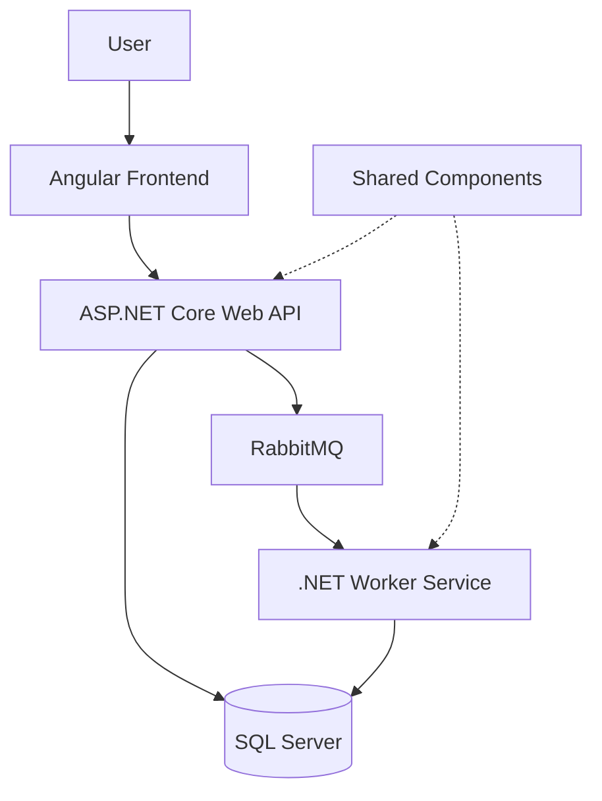

# Team Management System

A full-stack team management application for organizing tasks, tracking sprint progress, and improving visibility into team delivery.

This project is an independent software development project built to explore practical full-stack engineering, maintainable application architecture, and asynchronous background processing.

## Overview

The Team Management System provides a foundation for managing team tasks and monitoring work through a centralized application.

The solution is organized into separate application components:

- **Frontend:** Angular application
- **Backend:** ASP.NET Core Web API
- **Background processing:** .NET worker service
- **Shared components:** Common models and reusable code
- **Data storage:** SQL Server
- **Messaging:** RabbitMQ
- **Local development:** Docker Compose

## Features

> Update this section to include only features that are implemented and tested in the current version.

- Task creation and management
- Task editing and status tracking
- Kanban-style task board
- Sprint summary and progress visibility
- Audit trail for tracking relevant changes
- Background processing using a worker service
- Asynchronous communication through RabbitMQ
- Containerized local development environment

## Technology Stack

| Area | Technology |
|---|---|
| Frontend | Angular, TypeScript |
| Backend | C#, ASP.NET Core Web API |
| Background processing | .NET Worker Service |
| Database | SQL Server |
| Messaging | RabbitMQ |
| Architecture patterns | CQRS and Outbox Pattern, where implemented |
| Containers | Docker, Docker Compose |

## Repository Structure

```text
Team-management/
├── Shared/
├── TaskWorkerService/
├── team-management-api/
├── team-management-app/
├── Apps.sln
└── docker-compose.yml
```

- `team-management-app/` — frontend application.
- `team-management-api/` — backend API.
- `TaskWorkerService/` — background processing.
- `Shared/` — shared code used across application components.
- `Apps.sln` — solution file.
- `docker-compose.yml` — local development dependencies and services.

## Architecture

The application separates the user interface, API, and background processing responsibilities.



This diagram is a conceptual starting point. Adjust the connections to match the actual implementation—for example, whether the API publishes messages directly and whether the worker reads or writes particular database records.

## Running Locally

### Prerequisites

- Git
- Docker Desktop or Docker Engine with Docker Compose
- Node.js and npm for the Angular frontend

### 1. Clone the repository

```bash
git clone https://github.com/Gunnitsingh/Team-management.git
cd Team-management
```

### 2. Configure environment variables

Configure the SQL Server credentials and application connection strings using environment variables or a local environment file that is excluded from version control.

Never commit production credentials, access tokens, or other secrets.

### 3. Start the backend services

Build and start the API, background worker, SQL Server and RabbitMQ:

```bash
docker compose up --build -d
```

Check the running containers:

```bash
docker compose ps
```

Inspect service logs when troubleshooting:

```bash
docker compose logs -f api worker
```

### 4. Start the frontend

Run the Angular frontend separately using the scripts defined in `team-management-app/package.json`. Configure its API URL to point to the locally running backend.

### 5. Verify the application

- Confirm the API starts and responds to requests.
- Confirm SQL Server is ready and the database schema is initialized.
- Confirm RabbitMQ is accessible and the worker successfully connects.
- Test a complete task workflow, including any asynchronous processing involved.

**Note:** The commands above describe the intended local workflow. Database initialization, migrations, service readiness and frontend configuration must be verified against the current implementation before treating this setup as fully tested.

Check the Compose configuration and application settings for the required environment variables, ports, database initialization, and connection strings before starting the API, frontend, and worker.

**Note:** Add the exact commands for database migrations and launching each application once the clean-clone setup has been verified.

## Design and Engineering Focus

The project is intended to demonstrate practical engineering decisions around:

- Separation of frontend, API, and background worker responsibilities
- API design and database integration
- Asynchronous messaging
- Maintainable code organization
- Reliable processing and consistency patterns, where implemented
- Containerized development and repeatable setup

## Roadmap

Planned enhancements may include:

- Completing additional task and sprint workflows
- Expanding automated test coverage
- Improving deployment and CI/CD automation
- Evaluating AI-assisted sprint summaries and task insights

Roadmap items are planned enhancements, not claims about existing functionality.

## Project Status

Actively developed as an independent learning and portfolio project. Features and setup instructions will be updated as the implementation evolves.
