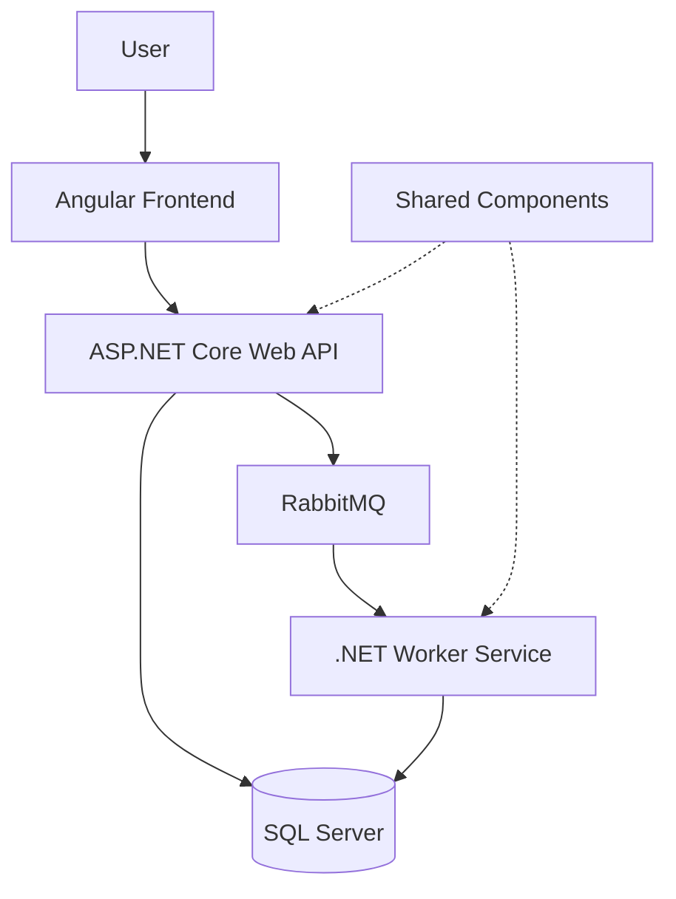

# Team Management System

A full-stack team management application for organizing tasks, tracking sprint progress, and improving visibility into team delivery.

This project is an independent software development project built to explore practical full-stack engineering, maintainable application architecture, and asynchronous background processing.

## Overview

The Team Management System provides a foundation for managing team tasks and monitoring work through a centralized application.

The solution is organized into separate application components:

- **Frontend:** Angular application
- **Backend:** ASP.NET Core Web API
- **Background processing:** .NET worker service
- **Shared components:** Common models and reusable code
- **Data storage:** SQL Server
- **Messaging:** RabbitMQ
- **Local development:** Docker Compose
- **LLM:** Ollama

## Features

> Update this section to include only features that are implemented and tested in the current version.

- Task creation and management
- Task editing and status tracking
- Kanban-style task board
- Sprint summary and progress visibility
- Audit trail for tracking relevant changes
- Background processing using a worker service
- Asynchronous communication through RabbitMQ
- Containerized local development environment

## Technology Stack

| Area | Technology |
|---|---|
| Frontend | Angular, TypeScript |
| Backend | C#, ASP.NET Core Web API |
| Background processing | .NET Worker Service |
| Database | SQL Server |
| Messaging | RabbitMQ |
| Architecture patterns | CQRS and Outbox Pattern, where implemented |
| Containers | Docker, Docker Compose |
| LLM | Ollama

## Repository Structure

```text
Team-management/
├── Shared/
├── TaskWorkerService/
├── team-management-api/
├── team-management-app/
├── Apps.sln
└── docker-compose.yml
```

- `team-management-app/` — frontend application.
- `team-management-api/` — backend API.
- `TaskWorkerService/` — background processing.
- `Shared/` — shared code used across application components.
- `Apps.sln` — solution file.
- `docker-compose.yml` — local development dependencies and services.

## Architecture

The application separates the user interface, API, and background processing responsibilities.



### Deployment and Runtime Architecture

- **API:** ASP.NET Core Web API running in Docker.
- **Background processing:** .NET Worker Service running in Docker.
- **Database:** SQL Server running in Docker, with persistent storage through the `sqlserver-data` volume.
- **Messaging:** RabbitMQ running in Docker.
- **Frontend:** Angular application started separately on the host machine during local development.
- **AI integration:** Ollama runs locally on the host machine. The API container connects to it using `http://host.docker.internal:11434` on Docker Desktop for Mac.

Docker Compose orchestrates the backend services and their dependencies. The Angular frontend and Ollama are started separately.


This diagram is a conceptual starting point. Adjust the connections to match the actual implementation—for example, whether the API publishes messages directly and whether the worker reads or writes particular database records.

### Prerequisites

- Git
- Docker Desktop or Docker Engine with Docker Compose
- Node.js and npm
- .NET SDK, if you want to run or debug backend components outside Docker
- Ollam installed (Optional for AI summary feature)


## Configuration

The application uses environment variables for database credentials and service configuration.

Create a local `.env` file alongside `docker-compose.yml`:

```dotenv
SA_PASSWORD=YourUniqueStrongLocalPassword123!
```

Ensure `.env` is listed in `.gitignore`. Never commit real credentials or secrets to the repository.

The Docker Compose configuration uses this password for the SQL Server container and the connection strings consumed by the API and worker.

The API's Ollama configuration specifies the host URL and model name. Ensure Ollama is running on the host and the configured model is available before generating AI sprint summaries.

For contributors, provide a `.env.example` containing placeholder values rather than actual credentials.

## Running Locally

### 1. Clone the repository

```bash
git clone https://github.com/Gunnitsingh/Team-management.git
cd Team-management
Configure .env.
```

### 2. Start the backend and dependencies

```bash
docker compose up --build -d
```

This starts the configured backend services and dependencies:

- ASP.NET Core API
- .NET background worker
- SQL Server
- RabbitMQ

Verify container status:

```bash
docker compose ps
```

### 3. Start the Angular frontend

Open a separate terminal:

```bash
cd team-management-app
npm install
npm start
```

Use the frontend URL printed by the development server. Ensure the frontend's API configuration points to the locally running backend.

If the project uses a different npm script, check `package.json` and substitute the appropriate command.

### 4. Verify the application

- Confirm all Docker services are running.
- Verify the frontend can communicate with the API.
- Test task creation and status updates.
- Verify RabbitMQ messaging and background processing.
- Confirm the audit trail and sprint summary work as expected.


### 5. Start or verify Ollama
- Confirm Ollama is running for AI summary feature

### Troubleshooting

Inspect backend and worker logs:

```bash
docker compose logs -f api worker
```

Inspect all container logs:

```bash
docker compose logs -f
```

**Note:** The Angular frontend currently runs separately from Docker Compose. The AI integration is under development and will be documented as a completed feature after it has been tested.

Check the Compose configuration and application settings for the required environment variables, ports, database initialization, and connection strings before starting the API, frontend, and worker.

**Note:** Add the exact commands for database migrations and launching each application once the clean-clone setup has been verified.

## Design and Engineering Focus

The project is intended to demonstrate practical engineering decisions around:

- Separation of frontend, API, and background worker responsibilities
- API design and database integration
- Asynchronous messaging
- Maintainable code organization
- Reliable processing and consistency patterns, where implemented
- Containerized development and repeatable setup

### AI-Assisted Sprint Summaries

- Generate AI-assisted sprint summaries using sprint and task data.
- Integrate a locally hosted language model through Ollama.
- Keep sprint records in the application database as the source of truth; AI generates summaries rather than modifying task records.

**Status:** Implemented and verified locally. Production deployment and resilience testing remain future improvements.

## Roadmap

Planned enhancements may include:

- Completing additional task and sprint workflows
- Expanding automated test coverage
- Improving deployment and CI/CD automation


Roadmap items are planned enhancements, not claims about existing functionality.

## Project Status

Actively developed as an independent learning and portfolio project. Features and setup instructions will be updated as the implementation evolves.
